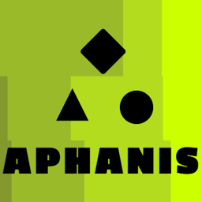

<div align="center">
  
  <h1>APHANIS</h1>
  <p><strong>(Sistema de Transferencia con Cifrado en el Cliente (Zero-Knowledge))</strong></p>
  <p>
    <strong>Next.js 16.4.6</strong> | <strong>React 19.3.0</strong> | <strong>TypeScript 5.x</strong> | <strong>AES-256-GCM</strong> | <strong>Licencia MIT</strong>
  </p>
  <p>
    <a href="https://aphanis-mono.vercel.app"><strong>Despliegue en Producción »</strong></a>
  </p>
</div>

---

## Stack Tecnológico

| Componente | Tecnología | Versión |
| :--- | :--- | :--- |
| Framework Full-Stack | Next.js (App Router, SSR) | 16.4.6 |
| Biblioteca de Interfaz | React / React DOM | 19.3.0 |
| Lenguaje | TypeScript | ^5.0.0 |
| Motor de Estilos | Tailwind CSS / PostCSS | 4.3.3 / 4.3.5 |
| Criptografía en Cliente | W3C Web Crypto API | Nativo en navegador |
| Base de Datos y Autenticación | Supabase (PostgreSQL, RLS, Stored Procedures) | @supabase/ssr ^0.12.7 |
| Servicio de Correo Transaccional (2FA) | Brevo REST API v3 | REST HTTP |
| Biblioteca de Iconos | Lucide React | ^1.74.0 |

---

## Guía de Instalación y Ejecución Local

Sigue estos pasos para clonar, configurar y ejecutar el proyecto en un entorno local:

### 1. Prerrequisitos
* Node.js: Versión 20.x o superior instalada (https://nodejs.org/).
* Gestor de paquetes: npm (incluido por defecto con Node.js).
* Git instalado en el sistema operativo.

### 2. Clonar el Repositorio
```bash
git clone https://github.com/TU_USUARIO/aphanis-mono.git
cd aphanis-mono
```

### 3. Instalar Dependencias
Instala los paquetes necesarios declarados en package.json:
```bash
npm install
```

### 4. Configurar Variables de Entorno
Crea un archivo llamado `.env.local` en la raíz del proyecto y define las siguientes variables requeridas para la conexión con los servicios de base de datos y correo (puedes tomar como referencia `.env.example`):

```env
# Conexión con Supabase (Autenticación y Persistencia)
NEXT_PUBLIC_SUPABASE_URL=https://tu-proyecto.supabase.co
NEXT_PUBLIC_SUPABASE_ANON_KEY=tu-supabase-anon-key

# Servicio de Correo Transaccional (Brevo) para 2FA OTP
BREVO_API_KEY=xkeysib-tu-api-key-de-brevo
BREVO_SENDER_EMAIL=tu-correo-verificado-en-brevo@correo.com
```

### 5. Ejecutar en Modo Desarrollo
Inicia el servidor local de desarrollo:
```bash
npm run dev
```

Abre el navegador web e ingresa a:
http://localhost:3000

### 6. Compilación y Ejecución para Producción (Opcional)
Para validar la compilación optimizada de producción:
```bash
# Compilar proyecto Next.js
npm run build

# Iniciar servidor de producción
npm run start
```

---

## Descripción del Proyecto

APHANIS es una plataforma web desarrollada para la transferencia segura de información confidencial, incluyendo secretos en texto plano y archivos adjuntos de hasta 10 MB.

El sistema opera bajo una Arquitectura de Conocimiento Cero (Zero-Knowledge): todos los procesos criptográficos de cifrado y descifrado se ejecutan exclusivamente en el navegador del usuario utilizando la Web Crypto API nativa. El servidor y la base de datos actúan únicamente como un intermediario ciego que almacena bloques binarios cifrados ininteligibles, sin tener acceso a las llaves de descifrado, y ejecuta la purga física e irreversible de los datos en cuanto se alcanza el límite de aperturas o el tiempo de expiración.

---

## Controles de Seguridad y Arquitectura

1. Cifrado de Extremo a Extremo (E2EE) con AES-256-GCM:
   * Generación obligatoria de llaves simétricas de 256 bits mediante CSPRNG (crypto.getRandomValues).
   * Vector de Inicialización (IV) único de 96 bits por cada operación para evitar ataques por patrones.
   * Autenticación de integridad mediante Auth Tag de 128 bits (GCM).
   * La llave de descifrado nunca se transmite ni se almacena en el servidor.

2. Autodestrucción Atómica en Base de Datos (PostgreSQL):
   * Procedimiento almacenado ejecutado con nivel de aislamiento y bloqueo pesimista de concurrencia (SELECT ... FOR UPDATE).
   * Al alcanzar la cuota de aperturas o expirar el tiempo, la base de datos ejecuta un DELETE físico permanente del contenido, respondiendo con Estado HTTP 410 GONE.

3. Control de Acceso por Lista Blanca y 2FA (OTP):
   * Restricción por lista de correos autorizados verificada mediante código OTP de 6 dígitos entregado vía Brevo API.
   * Mitigación de Timing Attacks: retardo artificial compensado a ~400 ms en el endpoint de solicitud de código para evitar la enumeración de usuarios por análisis de latencia.

4. Rate Limiting Persistente:
   * Control contra ataques de fuerza bruta persistido en PostgreSQL: 5 intentos fallidos consecutivos activan un bloqueo temporal de 15 minutos (locked_until).
   * Cooldown obligatorio de 60 segundos y máximo 5 solicitudes para la emisión de códigos OTP.

5. Inspección de Archivos y Magic Bytes (Anti-Malware / Anti-XSS):
   * Detección estricta de extensiones ejecutables y dobles extensiones (.exe.pdf, .bat, .sh, .vbs, etc.).
   * Inspección física de firmas de encabezado (Magic Bytes) para neutralizar binarios camuflados: Windows PE (MZ), Linux (.ELF) y macOS (Mach-O).
   * Descarga segura neutralizando tipos MIME a application/octet-stream y revocación asíncrona de Object URLs en memoria.

6. Cabeceras HTTP de Seguridad Perimetral:
   * Strict-Transport-Security: max-age=63072000; includeSubDomains; preload (HSTS).
   * X-Frame-Options: DENY (Protección contra Clickjacking).
   * X-Content-Type-Options: nosniff (Protección contra MIME Sniffing).
   * Referrer-Policy: strict-origin-when-cross-origin.
   * Ocultamiento de cabecera de tecnología (poweredByHeader: false).

---

## Estructura del Repositorio

```text
├── app/
│   ├── (auth)/             # Vistas de autenticación (login, registro, verificación)
│   ├── (dashboard)/        # Panel principal del usuario (crear transferencia, historial, grupos)
│   ├── (public)/[id]/      # Vista pública para recepción y descifrado del paquete
│   └── api/                # Endpoints seguros de la API (transfers, unlock, send-otp, groups)
├── components/
│   ├── layout/             # Componentes de estructura (Sidebar, SplashScreen)
│   ├── public/             # Componentes de visualización y descarga descifrada (DecryptedContent)
│   └── transfer/           # Componentes del formulario de envío (ContentCard, LimitsCard, PinCard)
├── lib/
│   ├── crypto.ts           # Funciones criptográficas cliente (AES-256-GCM, SHA-256, CSPRNG)
│   ├── repositories/       # Capa de acceso a datos y llamadas a Stored Procedures de Supabase
│   ├── services/           # Lógica de negocio (manejo de transferencias, envío de correos con Brevo)
│   └── supabase/           # Inicialización de clientes Supabase (browser y server con SSR)
├── next.config.ts          # Configuración de Next.js y cabeceras de seguridad HTTP
├── preview.png             # Vista previa oficial en alta resolución (1080p)
├── logo.png                # Logotipo oficial del proyecto (1:1)
├── LICENSE                 # Licencia oficial de código abierto (MIT)
└── package.json            # Dependencias y scripts del proyecto
```

---

## Equipo de Desarrollo

* Luis Alberto Pérez Montiel (243785) — Frontend, UI/UX Segura, Criptografía en Cliente (Web Crypto API).
* Luis Ali Rios Cristobal (243682) — Backend, Arquitectura de APIs, Seguridad en Base de Datos (PostgreSQL RPCs, RLS).

---

## Licencia

Este proyecto está bajo la Licencia MIT — consulta el archivo [LICENSE](LICENSE) para más detalles.

Copyright (c) 2026 Luis Alberto Pérez Montiel, Luis Ali Rios Cristobal.
